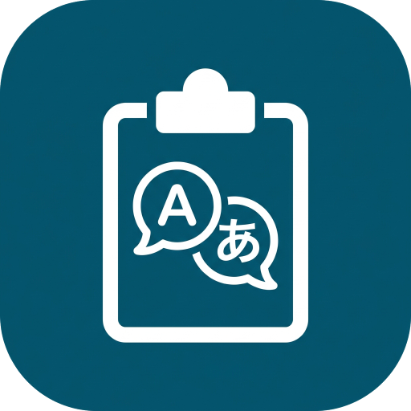

<p align="center"></p>

# clipboard-translator

[English](README.md) | 日本語

Windows、Linux（X11）、macOS 用の、日本語 <-> 英語のクリップボード翻訳ツールです。テキストを選択して
**Ctrl+Alt+E** を押し、翻訳結果を **Ctrl+V** で貼り付けます。

翻訳はすべて手元の PC で、[llama.cpp](https://github.com/ggml-org/llama.cpp) と
[PLaMo 3 Translate 2B (GGUF)](https://huggingface.co/pfnet/plamo-3-translate-2b-GGUF)
を使って行います。Ollama は不要です。Windows では Python も不要で、Linux／macOS ではセットアップ時だけ使用します。

**Built with PLaMo.** 翻訳モデルは Preferred Networks 社の PLaMo で、
[PLaMo コミュニティライセンス](https://plamo.preferredai.jp/info/plamo-community-license-ja)
のもとで利用しています。業務で使う場合は、先に[ライセンス](#ライセンス)の項を読んでください。

> **状態: プロトタイプ。** 幅広い PC や GPU ドライバーでの確認はできていません。
> 自己責任でお使いください。

## どれをダウンロードするか

[リリース](https://github.com/ypsilonmeister/clipboard-translator/releases)には、環境ごとに 1 つずつファイルがあります
(macOS と Linux のファイルには隣に `.sha256` ファイルが付きます。Windows の zip の SHA-256 はリリースノートに載ります)。

| お使いのコンピューター | ファイル | 手順 |
| --- | --- | --- |
| Windows 10/11 x64 | インストールスクリプト、Scoop、または `Portable-Clipboard-Translator-Windows-x64-<version>.zip` | [Windows](#インストールwindows-1011-x64) |
| Apple シリコンの Mac(M1 以降) | `clipboard-translator-macos-arm64-<version>.zip` | [macOS](#macos実験的対応macos-13-以降) |
| Intel プロセッサの Mac | `clipboard-translator-macos-amd64-<version>.zip` | [macOS](#macos実験的対応macos-13-以降) |
| Linux x86_64(X11 セッション) | `clipboard-translator-linux-amd64-<version>.tar.gz` | [Linux](#linuxx11実験的対応) |

macOS と Linux は実験的対応です。Linux arm64 用のビルドは配布していません。

## インストール(Windows 10/11 x64)

llama.cpp のビルドには **Visual C++ 再頒布可能パッケージ(x64)** が必要です。ほとんどの PC には
すでに入っています。入っていない PC(または非常に古い PC)では、`llama-server` が何も出力せず
終了コード `0xC0000135` ですぐに終了します。その場合、アプリが対処方法を表示します。
`winget install --id Microsoft.VCRedist.2015+.x64 -e` か
<https://aka.ms/vs/17/release/vc_redist.x64.exe> で入れてください。

### インストールスクリプト(おすすめ)

PowerShell を開き(管理者権限は不要です)、次を実行します。

```powershell
irm https://raw.githubusercontent.com/ypsilonmeister/clipboard-translator/main/install.ps1 | iex
```

スクリプトは、最新のリリースをダウンロードして SHA-256 を確認し、
`%LOCALAPPDATA%\ClipboardTranslator` に入れます。続けて PLaMo のモデル(1 GB 超)と llama.cpp
(CUDA / Vulkan / CPU は自動で選びます。CPU 版は予備として必ず入ります)をダウンロードし、
スタートメニューのショートカットと「設定 > アプリ」の項目を作って、アプリを起動します。
短いスクリプトなので、実行前に [`install.ps1`](install.ps1) を読んでもかまいません。

- **更新:** 同じコマンドをもう一度実行するか、トレイメニューの「Check for updates」を使います。
  トレイの「Update」は、インストールするリリースのインストーラースクリプトを実行します。
  `config.json`、モデル、llama.cpp はそのまま残ります。
- **アンインストール:** 「設定 > アプリ」の *Clipboard Translator* から、または
  `& ([scriptblock]::Create((irm https://raw.githubusercontent.com/ypsilonmeister/clipboard-translator/main/install.ps1))) -Uninstall`
  (アプリ自身のファイル(モデルと llama.cpp を含む)を削除し、ほかに何も残っていなければフォルダーも
  削除します)。インストールは空のフォルダーか新しいフォルダーにだけ行うので、他のファイルと混ざることはありません。
- **オプション**(`| iex` には引数を渡せないので環境変数で指定します):
  `CT_VERSION=v0.5.0` でリリースを固定、`CT_INSTALL_DIR=D:\Apps\CT` でフォルダーを指定、
  `CT_SKIP_SETUP=1` でモデルのダウンロードを省略、`CT_NO_LAUNCH=1` で起動しない。
  例: `$env:CT_VERSION='v0.5.0'; irm ... | iex`。スクリプトを保存して実行する場合は、同じ指定を
  引数(`-Version`、`-InstallDir`、`-SkipSetup`、`-NoLaunch`、`-Force`)でも行えます。

### Scoop

```powershell
scoop bucket add clipboard-translator https://github.com/ypsilonmeister/clipboard-translator
scoop install clipboard-translator
```

`models`、`runtime`、`config.json` は `scoop update` でも残ります。この方法は新しく、
インストールスクリプトほどは試されていません。

### ポータブル zip(手動)

[Releases](https://github.com/ypsilonmeister/clipboard-translator/releases) から
`Portable-Clipboard-Translator-Windows-x64-<バージョン>.zip` をダウンロードし、
書き込み可能なフォルダーに展開します。`ClipboardTranslator.exe`(または `Start.cmd`)を実行すると、
モデルや llama.cpp が無ければダウンロードを提案します。`Setup.cmd` なら最初にまとめてダウンロードします。
`Stop.cmd` はアプリと、その子プロセスの `llama-server` を止めます。「Start with Windows」は
exe のパスを `HKCU\...\Run` に登録します。フォルダーを移動したら、一度オフにしてからオンにし直してください。

バックエンドを手動で選ぶ場合:

```powershell
powershell -ExecutionPolicy Bypass -File .\setup.ps1 -Backend vulkan   # または cuda / cpu
```

### モデルのサイズを選ぶ

セットアップは、初期値で PLaMo 3 Translate **2B**(1.8 GB)を入れます。別のサイズを使うには:

```powershell
powershell -ExecutionPolicy Bypass -File .\setup.ps1 -Model 8b   # または 0.8b / 2b
```

| `-Model` | ファイル | ダウンロード |
| --- | --- | --- |
| `0.8b` | `plamo-3-translate-0.8b-Q4_K_M.gguf` | 0.6 GB |
| `2b`(初期値) | `plamo-3-translate-2b-Q4_K_M.gguf` | 1.8 GB |
| `8b` | `plamo-3-translate-8b-Q4_K_M.gguf` | 5.3 GB |

モデルは設定ページ(下記)でも選んでダウンロードできます。大きいモデルほど、ディスク容量、メモリ、1回あたりの翻訳時間が必要です。小さいモデルは速くなります。
31B は選べません。`-Model` を付けると、ファイルをダウンロードし(固定した SHA-256 で検証)、`config.json` の
`model_file` を書き換えます。以前のモデルのファイルは、削除するまで `models\` に残ります。`-Model` を付けない
セットアップ(Scoop の更新を含む)は、`config.json` に書かれているモデルのままにします。どのサイズも同じ
[PLaMo コミュニティライセンス](https://plamo.preferredai.jp/info/plamo-community-license-ja)です。
Linux と macOS では `--model 0.8b|2b|8b` を使います(例: `bash setup.sh --backend cpu --model 8b`)。

## macOS（実験的対応、macOS 13 以降）

### インストール手順

1. **お使いの Mac に合うファイルを選びます。** アップルメニュー > *この Mac について* のチップが
   *Apple M…* なら `arm64`、*Intel* なら `amd64` です。ターミナルで `uname -m` を実行しても分かります
   (`arm64` または `x86_64`)。
2. Releases から `clipboard-translator-macos-<アーキテクチャ>-<バージョン>.zip` と `.sha256` ファイルを
   **ダウンロード**し、2 つのファイルがあるフォルダーで内容を確認します。

   ```bash
   shasum -a 256 -c clipboard-translator-macos-<アーキテクチャ>-<バージョン>.zip.sha256
   ```

3. zip を**展開**し、**Clipboard Translator.app** を `/Applications`(または置いておきたい場所)へ移します。
4. **初回の起動。** このアプリは公証されていないため、macOS が開くのを拒否することがあります
   (表示や手順は macOS のバージョンで異なります)。最初に開こうとして拒否されたあと、
   *システム設定 > プライバシーとセキュリティ* で **このまま開く** を選ぶか、開く前に
   ダウンロード時の隔離属性を外してください。

   ```bash
   xattr -dr com.apple.quarantine "/Applications/Clipboard Translator.app"
   ```

5. Python 3.12 以降がなければ入れます(`brew install python`)。初回セットアップに必要です。
6. **アプリを起動**し、ダウンロードの確認(モデルは 1 GB 超)に同意します。そのあと、選択範囲をコピーできるように
   *システム設定 > プライバシーとセキュリティ > アクセシビリティ* で許可します。

以下に、それぞれの詳細を説明します。

CI は Apple Silicon（`arm64`）と Intel（`amd64`）用に、それぞれ
`clipboard-translator-macos-<アーキテクチャ>-<バージョン>.zip` と SHA-256 ファイルを作成します。
開発版は PR の Actions 成果物、タグ付きビルドは Releases から取得できます。
対応する zip を展開し、権限を与える前に **Clipboard Translator.app** を最終配置先（例: Applications）へ移してください。
これは **ad-hoc 署名の開発用ビルド**です。Developer ID 署名・公証は含まず、Gatekeeper の受け入れや
一般配布の署名手順は未検証です。
開発用ビルドの置き換え後は、アクセシビリティ権限の再設定が必要になる場合があります。

初回セットアップには `tarfile.data_filter` が使える Python（3.12 以降、またはセキュリティ更新済みの
3.10／3.11）が必要です。例えば Homebrew で Python を導入してください。
アプリを開き、ダウンロードの確認に同意すると、キャンセル可能なセットアップウィンドウを表示します。
詳細は `setup.log` に記録します。公式 llama.cpp アーカイブは GitHub 公開の SHA-256 と照合し、
標準で Metal を使用します。同じランタイムを CPU としても利用でき、メニューから切り替えられます。
モデルとチャットテンプレートは、Windows／Linux と同様に、新しくダウンロードしたものを固定した SHA-256 と照合します(サイズの確認は、すでにディスクにあるファイルを守るためだけです)。

アプリは Dock ではなく **メニューバー**に常駐します。標準のキーは **Control+Option+E**
（設定上は `Ctrl+Alt+E`）、貼り付けは **Command+V** です。
選択テキストの取得（Cmd+C の送信）と任意の自動貼り付け（Cmd+V）には、
**システム設定 > プライバシーとセキュリティ > アクセシビリティ**でアプリへの許可が必要です。
メニューの **Open Accessibility Settings...** から設定ページを開けます。権限の要求は自動では行いません。
許可がない場合も、手動で Cmd+C → ホットキー → Cmd+V と操作してクリップボードを翻訳できます。
自動貼り付けは初期オフで、修飾キーを離した後にも最前面のプロセスとウィンドウを確認します。
同じウィンドウ内の選択変更は確実に検出できず、クリップボードの比較・置換も不可分な操作ではありません。
アプリのサンドボックスや Secure Input により操作できない場合があります。

設定・モデル・ログはアプリ本体を変更せず、次の場所に保存します。

```text
~/Library/Application Support/ClipboardTranslator/
    config.json, setup.sh, setup.log, translator.log, server.log
    models/, runtime/
```

埋め込みの macOS 用スクリプトはここに `setup.sh` として保存します。
手動で CPU に切り替える場合はアプリを終了し、
`bash "$HOME/Library/Application Support/ClipboardTranslator/setup.sh" --backend cpu`
を実行します（Metal は `metal`）。**Start at login** は
`~/Library/LaunchAgents/com.github.ypsilonmeister.clipboard-translator.plist` だけを管理し、
次回ログインから適用します。アプリを移動した場合は設定を入れ直してください。
更新は終了してアプリを置き換える方式で、Application Support のデータは残ります。
状態やエラーの通知はメニューバーのツールチップとログに表示し、通知センターの権限は要求しません。
操作が必要なエラーにはネイティブダイアログも使用します。

Mac または GitHub の macOS ランナーで Go と Xcode Command Line Tools を用意し、
`bash tools/package-macos.sh dev` を実行すると、その環境のアーキテクチャ向けにビルドします。
`.app` の情報・アイコン・ad-hoc 署名と検証を行い、`dist/` に zip とチェックサムを作成します。
CI は Apple Silicon／Intel の両方で、AppKit、クリップボード、Carbon ホットキーの登録・イベント配送、
メニューを検証します。キー送信やアクセシビリティ権限の付与は行いません。
他アプリでの選択取得・貼り付け、US 以外のキーボード、Gatekeeper、Metal の性能は実機での確認が必要です。
`CGO_ENABLED=0` のクロスコンパイルではロジックとスタブのみを確認できます。

## Linux（X11、実験的対応）

### インストール手順

1. **X11(Xorg)セッション**でログインします。`echo $XDG_SESSION_TYPE` が `x11` を表示する必要があります。
2. 依存パッケージ(下記の Ubuntu 24.04 の例)を入れたあと、Releases から
   `clipboard-translator-linux-amd64-<version>.tar.gz` と `.sha256` ファイルをダウンロードします(x86_64 のみ)。
   内容を確認し、ホーム以下の専用フォルダーに展開して実行します。

   ```bash
   sha256sum -c clipboard-translator-linux-amd64-<version>.tar.gz.sha256
   tar -xzf clipboard-translator-linux-amd64-<version>.tar.gz -C ~
   cd ~/clipboard-translator-linux-amd64-<version>
   bash setup.sh            # モデルと公式 CPU ランタイムを取得
   ./clipboard-translator
   ```

以下に、それぞれの詳細を説明します。

[#13](https://github.com/ypsilonmeister/clipboard-translator/issues/13) の最初の段階として Linux に対応しています。
**Wayland セッション（XWayland を含む）は非対応**です。
ログイン時に Xorg／X11 セッションを選んでください。

Ubuntu 24.04 では、実行に必要なパッケージを入れます。

```bash
sudo apt-get install libgtk-3-0t64 libxtst6 python3 xdg-utils libnotify-bin
```

Releases の Linux 用 `tar.gz` をホーム以下の書き込み可能な専用フォルダーに展開し、実行します。

```bash
cd clipboard-translator-linux-amd64-<version>
bash setup.sh                  # モデルと公式 CPU ランタイムを取得
./clipboard-translator
# Vulkan ドライバーが使える環境で、明示的に追加する場合:
bash setup.sh --backend vulkan
```

セットアップには `tarfile.data_filter` が使える Python（3.12 以降、またはセキュリティ更新済みの
3.10／3.11）が必要です。ランタイムのアーカイブは GitHub 公開の SHA-256 と照合します。
標準は CPU で、Vulkan が起動できなければ導入済みの CPU に切り替わります。
モデルとチャットテンプレートは、Windows と同様に、新しくダウンロードしたものを固定した SHA-256 と照合します(サイズの確認は、すでにディスクにあるファイルを守るためだけです)。
ランタイムの共有ライブラリとリンクはアーカイブの配置を保って導入します。
配布元ランタイムのシステム要件も適用されます。古いディストリビューションでは、対応する
llama.cpp を自身でビルドし、`runtime/cpu/llama-server` に配置する必要があります。

Linux では Ctrl+C を送らず、X11 の **PRIMARY** 選択から直接読み取り、翻訳前に CLIPBOARD に入れます。
ホットキーを押したウィンドウにフォーカスがあるときに作られた選択だけを自動貼り付けの対象にします。PRIMARY が
別ウィンドウに残っている場合や判別できない場合は、その文字を翻訳しますが自動貼り付けはしません。PRIMARY に文字がないときは、
既存の CLIPBOARD を使います。
X11 にクリップボードの不可分な比較・置換機能はないため、書き込み直前に文字を比較しますが、
Windows のように他アプリとの競合を完全には防げません。クリップボードマネージャーがない場合、
終了時にクリップボードの内容が失われることがあります。

トレイとメニューは GTK 3 で表示します。互換性のあるトレイ領域がない環境では、小さな操作ウィンドウを
表示し、メニューや Quit を使えるようにします。通知には任意で `notify-send` を使用します。
自動貼り付けは初期オフで、XTest による Ctrl+V を使用し、修飾キーを離した後にもフォーカスを確認します。
同じウィンドウ内での選択変更は確実に検出できないため、必要に応じて手動で貼り付けてください。
**Start at login** は `~/.config/autostart/clipboard-translator.desktop` のみを管理します
（`XDG_CONFIG_HOME` があればその下）。移動後は一度オフにしてからオンにし直してください。
メニューの Quit、SIGTERM、実行ファイル隣の `STOP` ファイルで終了できます。
Linux の更新は、終了して実行ファイルとセットアップスクリプトを置き換え、`config.json`、`models`、
`runtime` を残す方法です。PowerShell インストーラーと Scoop は Windows 専用です。

Ubuntu 24.04 上でソースからビルドする場合（Go 1.21 以降と C コンパイラーが必要）:

```bash
sudo apt-get install build-essential pkg-config libgtk-3-dev libx11-dev libxtst-dev
bash tools/package-linux.sh dev
# dist/clipboard-translator-linux-amd64-dev.tar.gz を書き込み可能なフォルダーへ展開します。
```

`CGO_ENABLED=0` のビルドはロジックのテスト用で、Linux のデスクトップ機能は使えません。
CI では隔離した Xvfb 環境で入力、PRIMARY／CLIPBOARD、貼り付け、メニューを検証します。
翻訳品質、実際のデスクトップでのトレイ表示、GPU ドライバーは実機での確認が必要です。

## 使い方

アプリは**システムトレイ**(通知領域)に常駐します。Windows 11 では `^` の中に隠れていることが
あります。モデルの読み込みが終わると「Ready」の吹き出しが出ます。ツールチップには状態と、
読み込み中・翻訳中の経過秒数が出ます。

日本語または英語のテキストを選択して `Ctrl+Alt+E` を押します。翻訳が終わると、結果が
クリップボードに入るので、`Ctrl+V` で貼り付けます。何も選択していないときは、
クリップボードにあるテキストを翻訳します。

トレイアイコンを右クリックすると、次のメニューが出ます(表示はすべて英語です)。

| 項目 | 内容 |
| --- | --- |
| **Cancel translation** | 翻訳中だけ表示されます。 |
| **Recent translations** | 直近 10 件。メモリ上だけに保持し、ディスクには書きません。クリックすると、その翻訳をもう一度クリップボードにコピーします。*Clear history* で空にします。 |
| **Settings...** | ブラウザで設定ページを開きます。ホットキー(キー、言語のペアまたは翻訳先の言語)の追加・変更・削除、自動貼り付け、翻訳する文字数の上限、翻訳モデル(サイズのダウンロードと、導入済みのモデルの切り替え)、エンジンを設定できます。`config.json` に保存されます(「設定ページ」を見てください)。 |
| **Paste automatically after translating** | 初期はオフです。オンにすると Ctrl+V を自動で送ります。ただし、選択したテキストを翻訳した場合で、かつ同じウィンドウが手前にあるときだけです。それ以外はクリップボードに入れて待ちます。 |
| **Hotkey** | 別のキーの組み合わせを選びます。他のプログラムが使っている場合は、元のキーのままです。 |
| **Languages** | 双方向に翻訳する言語のペアです(初期値は日本語 ↔ 英語)。すぐに有効になります。ほかのペアは下の `languages` を見てください。 |
| **Translation engine** | インストール済みの llama.cpp(CPU、CUDA、Vulkan)を切り替えます。2 種類以上あるときだけ表示されます。 |
| **Check for updates** | クリックしたときだけ GitHub に最新リリースを問い合わせます。アプリが勝手に確認することはありません。 |
| **Open config.json** | そのほかの設定は[設定](#設定)を見てください。 |
| **Built with PLaMo (license)** | PLaMo コミュニティライセンスを開きます。 |
| **Start with Windows** | オン/オフの切り替え。 |
| **Open log** / **Quit** | |

翻訳サーバー(`llama-server`)が予期せず止まったときは、自動で再起動します(1 秒、2 秒、4 秒...と間隔を空けます)。
10 分以内に 3 回再起動しても直らなければ、メッセージを出して終了します。起動時のエラーはメッセージボックスに出て、
`translator.log` にも書かれます。

## プライバシーとネットワーク

- 翻訳は手元の PC で行います。サーバーは `127.0.0.1` だけで待ち受けるので、ほかのコンピューターからは接続できません。
  ただし同じ PC のプログラム(ブラウザで開いた Web ページを含む)は `127.0.0.1` に接続できるため、
  アプリはサーバーを起動するたびにランダムなキーを渡し、サーバーはそのキーのない翻訳などの API リクエストを拒否します
  (状態確認用の `/health` はキーなしでも応答します)。llama-server に組み込みの Web UI も無効にするよう指定しています
  (`LLAMA_ARG_UI=0`。現在の llama.cpp のビルドが読み取ります)。
- アプリがネットワークに接続するのは、操作したときだけです。モデルと llama.cpp のダウンロード
  (`Setup.cmd`、`setup.ps1`、初回起動時の提案、インストールスクリプト)と、「Check for updates」「Update」です。
  テレメトリーも、バックグラウンドでの確認もありません。
- 「Settings...」は、アプリ自身が `127.0.0.1` で提供するページを開きます(空いているポートで、ページを開いている間だけ。
  最後のアクセスから数分後か、「Close this page」で閉じます)。アドレスに含まれるランダムなトークンで保護され、
  インターネットからは何も読み込みません。
- 設定ページはモデルをダウンロードできます。取得するのはそれだけで、「Download」を押したときだけ、
  `huggingface.co` から、そのモデルの固定したリビジョンだけを取得し、SHA-256 が固定値と一致したファイルだけを使います。
  ダウンロードはページを閉じても続き、ページから中止できます。中止や失敗のとき、途中までのファイルは残り、
  次回はその続きから再開します。
- ログにはエラーを記録しますが、翻訳したテキストは記録しません。翻訳履歴はメモリ上だけにあり、
  アプリを終了すると消えます。

## 設定

`config.json`(パスはすべてアプリのフォルダーからの相対パスです)。トレイメニューから変えられるのは
`hotkey`、`languages`、`server_file`、`gpu_layers`、`auto_paste` です。そのほかは手で編集し、再起動が必要です。
変更前のファイルは `config.json.bak` として残ります。

| キー | 内容 |
| --- | --- |
| `hotkey` | 修飾キー + A〜Z の 1 文字。例: `Ctrl+Alt+E`(macOS では `Cmd` / `Command` と `Option` も使えます) |
| `auto_paste` | `true` で翻訳後に Ctrl+V を自動入力(初期値は `false`) |
| `languages` | 双方向に翻訳する 2 つの言語コード。例: `["ja", "en"]`(初期値)、`["en", "ko"]`、`["ja", "zh-hans"]`。コードはモデルのものです: `ja en ko zh-hans zh-hant ru th ar de fr es ...`(全 53 言語。[モデルカード](https://huggingface.co/pfnet/plamo-3-translate-2b-GGUF)を見てください)。翻訳の向きはテキストの文字種から決めるため、2 つの言語は別の文字を使うものにしてください(en ↔ de は今のところ拒否されます)。主な用途は日本語 ↔ 英語で、ほかの言語はベストエフォートです。 |
| `profiles` | ホットキーごとに言語を割り当てます。例: `[{"hotkey": "Ctrl+Alt+E", "languages": ["ja", "en"]}, {"hotkey": "Ctrl+Alt+K", "target": "ko"}]`。各プロファイルには `languages`(ペア。双方向)か `target`(常にその言語へ翻訳。原文の言語はモデルが判定するので、どの言語でも使えます。`en` と `de` のように文字が同じペアは、`target` のプロファイルを1つずつ作ってください)のどちらか一方を書きます。`hotkey` と `languages` の代わりになり、トレイメニューが編集するのは先頭のプロファイルです。Windows では最大 8 個。Linux と macOS では今のところ最初の 1 個だけ登録し、有効にならなかったものは通知で知らせます。他のプログラムが使っているホットキーは、そのプロファイルだけが無効になります。 |
| `port` | ローカルの llama-server のポート(1024〜65534。アプリは `port + 1` も多重起動の防止に使います) |
| `max_chars` | これより長いテキストは翻訳しません |
| `gpu_layers` | GPU に載せる層の数(`0` は CPU のみ) |
| `model_file` | 使うモデル。例: `models/plamo-3-translate-8b-Q4_K_M.gguf`。`setup.ps1 -Model` が設定します(「モデルのサイズを選ぶ」を見てください) |
| `server_file` / `fallback_server_file` | llama-server の実行ファイル(通常用 / CPU の予備) |

> `setup.ps1` が `server_file`、`fallback_server_file`、`gpu_layers` を検出したバックエンドに合わせて設定するのは、
> 新規インストールのとき、`-Backend cuda|vulkan|cpu` を明示したとき、GPU 版を新しくインストールしたときです。
> 通常の再実行や更新(Scoop のように `-Backend auto`)では、使用中のエンジンと `gpu_layers` はそのまま残ります。
> 不足している、または不完全なバックエンドだけをダウンロードし、すべてのダウンロードを SHA-256 で検証します
> (モデルファイルは特定のリビジョンに固定しています)。

## 設定ページ

トレイメニューの「Settings...」で、ブラウザに開きます(提供のしかたは「プライバシーとネットワーク」を見てください)。
次の設定ができます。

- **ホットキー**(キーと、言語のペアまたは翻訳先の言語の組。`config.json` の `profiles`)、**自動貼り付け**、
  **翻訳する文字数の上限**(`max_chars`)。これらは「Save」で反映されます。
- **翻訳モデル**: 「Download」で、まだ持っていないサイズを取得します(進捗表示と「Cancel」つき。31B は選べません)。
  「Use this model」で、導入済みのモデルへ切り替えます。切り替えでは `llama-server` を起動し直すので、少し時間が
  かかります。新しいモデルを読み込めなかったとき(メモリ不足など)は、前のモデルに戻し、ページに理由を表示します。
- **エンジン**(CPU、CUDA、Vulkan): 2 種類以上入っているときだけ選べます。

そのほかの設定は `config.json` に残ります。

## 制限事項

- アプリによっては、選択範囲を読むための擬似的な Ctrl+C を受け付けません。
- 選択範囲を読むとクリップボードが変わります。翻訳結果は、クリップボードのテキストが取得時のまま
  のときだけ、それを置き換えます。
- 1 つのホットキーで使える言語のペアは 1 つで、2 つの言語は別の文字を使うものに限ります(en ↔ de や、簡体字 ↔ 繁体字は、文字から向きを判別できません。それぞれ `target` のプロファイルを作ってください)。日本語と中国語を同じペアにした場合、漢字だけのテキストは中国語、かなが入っていれば日本語として扱います。URL は翻訳しません。
- GPU のバックエンドは失敗することがあります(VRAM 不足、古いドライバー、DLL の不足など)。その場合は
  CPU 版に切り替わります。詳しくは `server.log` と `translator.log` を見てください。
- exe はコード署名していないため、ブラウザーでダウンロードした zip では、SmartScreen の警告が出ることが
  あります(インストールスクリプトで取得したファイルには出ません)。

## ビルド（Windows）

[Go](https://go.dev/) 1.21 以降が必要です。

```powershell
go test ./...

# リリース用: コンソールを出さず、トレイアイコンだけで動きます
go build -ldflags "-H=windowsgui -s -w" -o ClipboardTranslator.exe .

# デバッグ用: コンソールを残して、ログをそこに出します
go build -o ClipboardTranslator.exe .
```

アイコン、エクスプローラーに表示されるバージョン情報、アプリケーションマニフェスト(モニターごとの DPI 対応。
拡大表示でもトレイのアイコンとメニューがぼやけません)は、`resource_windows_amd64.syso` からリンクされます。
Go のツールチェーンが自動で取り込み、標準ライブラリだけで生成できます。

```powershell
go run ./tools/mkicon                    # assets/icon-source.jpg -> assets/icon.ico, assets/icon.png
go run ./tools/mksyso -version 0.5.1     # アイコン + assets/app.manifest + バージョン -> resource_windows_amd64.syso
```

コミット済みの `.syso` には、直近のリリースのバージョンが入っています。リリースのワークフローが、タグから
作り直し、`main.version` も設定します。「Check for updates」はこれを最新のリリースと比べます(手元のビルドは
「development build」と表示され、古いと判定されることはありません)。`setup.ps1` は exe に埋め込まれています。

## CI とリリース

- `.github/workflows/ci.yml` は、`main` への push と、すべての Pull Request で、Windows 上の `gofmt`、
  `go vet`、`go test`、リリース用のフラグでのビルドを行い、PowerShell の構文も確認します。
  Linux では Xvfb 上の X11 デスクトップ機能、セットアップのフィクスチャテスト、tarball 作成も検証します。
  macOS は Apple Silicon／Intel の両方でネイティブテストとアプリの作成を行います。
- `v0.6.0` のようなタグを push すると、`.github/workflows/release.yml` が動きます。タグをバージョンとして
  exe をビルドし、`Portable-Clipboard-Translator-Windows-x64-<タグ>.zip` にまとめて、GitHub のリリースに
  添付します。Ubuntu 24.04 で作成した Linux amd64 用 tarball と SHA-256 ファイルも添付します。
  macOS Apple Silicon／Intel 用の ad-hoc 署名済みアプリ zip と SHA-256 ファイルも添付します。
  そのタグのリリースがすでにあれば、成果物を追加します。
- `bucket/clipboard-translator.json` は Scoop のマニフェストです。リリースのたびに更新します
  (`scoop checkver -u` でできます)。

不具合の報告や機能の要望には、Issue フォームを使ってください。アプリのバージョン、インストール方法、
ログの抜粋を尋ねます。

## ライセンス

このリポジトリは [MIT License](LICENSE) です。

モデルと llama.cpp は同梱していません。`setup.ps1`／`setup.sh` が公式の配布元からダウンロードします。
それぞれ別のライセンスです。

**PLaMo。** モデルは Preferred Networks 社の
[PLaMo コミュニティライセンス](https://plamo.preferredai.jp/info/plamo-community-license-ja)
のもとで利用しています(**Built with PLaMo**)。この README を書いた時点の条文から要約すると
(条文は変更されることがあります)、事業や営利のために使う場合(組織内部での利用を含みます)は、
事前に提供元の登録ページに登録し、かつ、ご自身(と関係会社)の直近事業年度の収入または売上が 10 億円を
超えなければ、無償で利用できます。モデルやその出力を第三者に提供する人は、「Built with PLaMo」の表示と
ライセンスのコピーの提供が必要で、モデルが生成したテキストを公表するときは、そのことを明示する必要があります。
必ずライセンス本文を読んでください。この要約は法的な助言ではありません。ライセンスには寄付についての
記載がなく、受け取ることが商業利用にあたるかどうかは、提供元に確認すべき事項です。

[llama.cpp](https://github.com/ggml-org/llama.cpp) は MIT ライセンスです。
